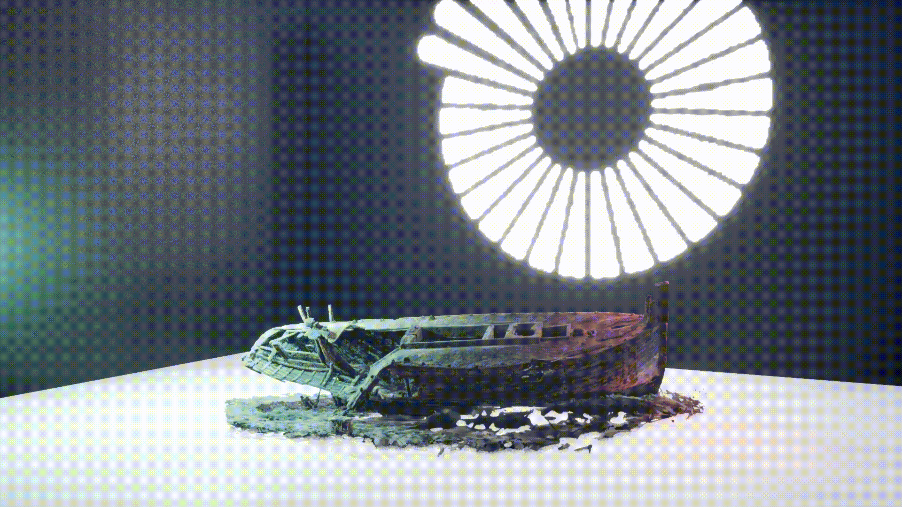

# Sample Project for [StarLightGS](https://github.com/CoSTAR-National-Lab/starlightgs)


Sample project for [StarLightGS](https://github.com/CoSTAR-National-Lab/starlightgs), a Gaussian Splat plugin for Unreal Engine featuring relighting and native shadow casting support.

See the [StarLightGS README](https://github.com/CoSTAR-National-Lab/starlightgs) and [usage guide](https://github.com/CoSTAR-National-Lab/starlightgs/blob/main/Docs/StarLightGS_Usage_Guide.md) for detailed instructions on using the plugin.

The assets used in this project were produced using [StarLightGS Training Pipeline](https://github.com/CoSTAR-National-Lab/starlightgs-training). To work with relighting, Gaussian Splat assets must have per-splat normal vectors and material properties (metallic/roughness). See the [training pipeline README](https://github.com/CoSTAR-National-Lab/starlightgs-training) for details on how to create your own relightable Gaussian Splat assets.

> [!TIP]
> Download pre-compiled binaries from the [Releases](https://github.com/CoSTAR-National-Lab/starlightgs-sample/releases/).

## Requirements
- Unreal Engine 5.7 or newer.
- Visual Studio 2022 or newer.

## Getting Started
Download pre-compiled binaries for Unreal Engine 5.7 and 5.8 from the [Releases](https://github.com/CoSTAR-National-Lab/starlightgs-sample/releases/).
### Build from Source
1. Clone this repository with submodules:
    ```sh
    git clone --recursive https://github.com/CoSTAR-National-Lab/starlightgs-sample
    ```
    If you cloned without submodules, then you can run this command:
    ```sh
    git submodule update --init
    ```
2. Right-click on `StarLightSample.uproject` and select `Generate Visual Studio project files` (you will have to click `Show more options...` first on Windows 11).
3. Open the generated `StarLightSample.sln`.
4. Press F5 within visual studio to build and run the sample project.

## Asset Credits

Assets in this sample project (excluding Suzanne) were produced from datasets acquired from third party sources. The datasets were turned into relightable gaussian splat assets using our [StarLightGS Training Pipeline](https://github.com/CoSTAR-National-Lab/starlightgs-training). They are provided as sample assets for our [StarLightGS](https://github.com/CoSTAR-National-Lab/starlightgs) plugin.

We would particularly like to thank [Mike Caronna](https://www.linkedin.com/in/mikecaronna/) from [Starling Labs](https://www.linkedin.com/company/starlinglab/home/) for his support and feedback, and especially for providing the excellent boat dataset.

Source Name|Rights Holder|Source License
-|-|-
Shipwreck*|Mike Caronna|CC BY-NC-SA
Mip-NeRF 360 Dataset ("garden" scene)*|Google LLC|Apache License 2.0
Suzanne|Blender / Willem-Paul van Overbruggen|GNU gpl-3.0

\* these assets are **not for commercial use**, as they were produced using our [StarLightGS Training Pipeline](https://github.com/CoSTAR-National-Lab/starlightgs-training) which uses [graphdeco-inria/gaussian-splatting](https://github.com/graphdeco-inria/gaussian-splatting/blob/main/LICENSE.md) which is licensed for research and evaluation uses only.

## License
This project is licensed under the CC BY-NC-SA 4.0 license - see the LICENSE file for details.
